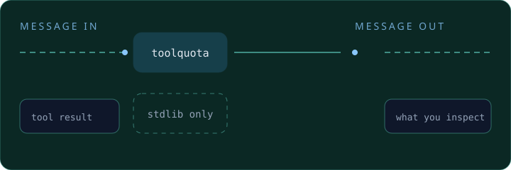

<p align="center">
  
</p>

<p align="center">
  <a href="https://pypi.org/project/toolquota/"></a>
  <a href="https://pypi.org/project/toolquota/"></a>
  <a href="https://pypi.org/project/toolquota/"></a>
  <a href="https://github.com/sandeshbagmare/toolquota/actions/workflows/ci.yml"></a>
  <a href="https://github.com/sandeshbagmare/toolquota/blob/main/LICENSE"></a>
  <a href="https://sandeshbagmare.github.io/toolquota/"></a>
  <a href="https://pypi.org/project/toolquota/"></a>
</p>

<h3 align="center">client-side rate limits your agent loop can wait on</h3>
<p align="center"><em>Standard library only. No runtime dependencies. Python 3.9+.</em></p>

<p align="center">
  
</p>

## Install

```console
pip install toolquota
```

## Use

```python
from toolquota import Quota, QuotaExceeded, ToolQuota

quota = ToolQuota(
    default=Quota(rate=1, burst=3),                       # any tool: 1/s, 3 at once
    quotas={
        "search": Quota(rate=10 / 60, burst=2, max_calls=40),
        "browser": Quota(rate=1 / 5, burst=1, max_calls=12),
    },
)

def call_tool(name, arguments, tool):
    if not quota.try_acquire(name):
        wait = quota.wait_time(name)
        if wait == float("inf"):
            return {"error": f"{name} has used its whole quota for this run"}
        return {
            "error": f"{name} is rate limited; wait {wait:.1f}s, or tell the user",
            "retry_after": wait,
        }
    return tool(**arguments)
```

Or let it raise:

```python
try:
    quota.acquire("search")
except QuotaExceeded as error:
    error.wait_time       # seconds, or inf when max_calls is spent
    error.permanent       # True when no amount of waiting helps
    str(error)            # "'search' is rate limited; retry in 0.40s"
```

Reading it back:

```python
quota.remaining("search")   # calls available now
quota.calls("search")       # calls taken since reset
quota.report()              # {"search": {"calls": 7, "available": 1.4}}
quota.reset()               # new run
```

## How the bucket works

- each tool starts with a full bucket of `burst` calls
- calls are deducted on acquire; tokens refill at `rate` per second, capped at `burst`
- `max_calls` is an absolute cap for the run and never refills — use it for paid tools
  and for tools that must not be hammered at all
- `wait_time` is exact for a token bucket: `(count - available) / rate`
- the clock is injectable, so tests do not sleep:

```python
now = 0.0
quota = ToolQuota(clock=lambda: now)
```

## Rules

- A quota is per process. Two workers each get their own bucket, which is usually right
  for an agent and wrong for a shared API key — share a bucket through your own store if
  that is the case.
- `rate` is calls per second: `Quota(rate=10/60, burst=2)` is ten calls a minute.
- `try_acquire` never blocks and never sleeps. Sleeping is the caller's decision, which
  is why `wait_time` is returned rather than used.
- `reset()` at the start of a run, or keep one object for the process if the limits are
  really per process.

## Limits

- It limits; it does not queue or schedule. There is no async version: a token bucket is
  arithmetic, so call it from either kind of code.
- No distributed store, no Redis backend, no persistence. Deliberate: a limiter that
  needs a server is a limiter that breaks the run when the server is down.
- Retries of a failed call count against the quota, which is what the server sees too.

## Development

```console
python -m venv .venv
.venv/bin/pip install -e ".[test]"
.venv/bin/pytest
```

The suite covers every line of the package (`pytest --cov --cov-branch`), and the
examples in the docstrings run as tests through `--doctest-modules`.

## License

MIT.
